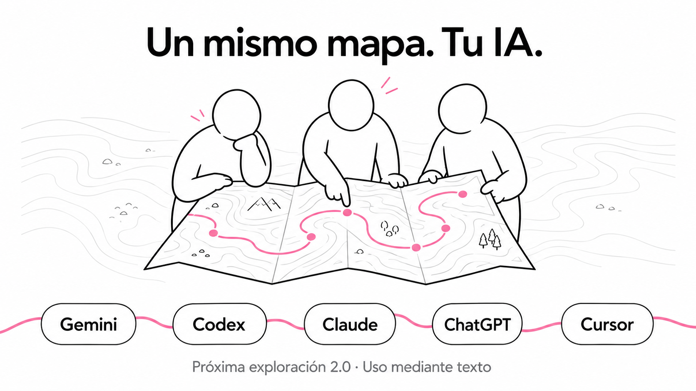

# Próxima exploración · 2.0

### Aprender juntos para cambiar cómo trabajamos.

**Un recurso de _Cartografías de lo liminal_ · Raúl Marín · Shift+R**

Un marco sencillo para convertir las dificultades del día a día en pruebas compartidas, aprendizajes y decisiones. Incluye un mapa editable, una skill portable y un agente definido mediante instrucciones. Puedes utilizarlo en Gemini, Claude, ChatGPT, Codex, Cursor y otros asistentes capaces de seguir instrucciones en texto. **El método viaja contigo; el mapa conserva la continuidad.**

[Empezar](#empieza-con-una-dificultad-real) · [Instalación](docs/instalacion.md) · [Ejemplo completo](ejemplos/caso-completo.md) · [Guía del equipo](docs/guia-del-equipo.md) · [Fuentes y conectores](docs/fuentes-y-conectores.md)

## ¿Qué visión propone?

Aprender dentro del trabajo: con otras personas, sobre dificultades concretas y conectando lo aprendido con las decisiones.

Cuando cambia el territorio, el mapa necesita revisarse. Lo que aparece en una entrega, una conversación o una comunidad puede convertirse en una pregunta; esa pregunta, en una prueba pequeña; y lo observado, en una decisión sobre cómo trabajar.

**Como en el gimnasio, la constancia importa.** Elegimos algo asumible, lo practicamos y volvemos a revisarlo. La siguiente exploración parte de lo aprendido.

Este recurso es un punto de partida que cada equipo puede adaptar.

## Cuatro preguntas para empezar

| Pregunta | Qué deja por escrito |
| --- | --- |
| **¿Qué nos está costando?** | Una dificultad real y un ejemplo que la haga visible. |
| **¿Qué queremos averiguar?** | Una pregunta que podamos poner a prueba. |
| **¿Cómo podemos probarlo juntos?** | Una tarea pequeña, participantes, tiempo y qué observar. |
| **¿Qué nos hará cambiar de rumbo?** | Señales para seguir, ajustar o parar. |

Después de la prueba, el mismo mapa recoge evidencias, aprendizajes, decisiones y el próximo paso.

## Empieza con una dificultad real

1. Abre [**INICIO-RAPIDO.md**](INICIO-RAPIDO.md), copia todo su contenido y pégalo en tu asistente de IA. También puedes adjuntarlo si el cliente lee Markdown.
2. Completa la dificultad, un ejemplo real y el tiempo disponible al final del texto.
3. Revisa el mapa propuesto con el equipo y conserva una copia para la siguiente sesión.

**No necesitas instalar nada.** El archivo contiene el agente, el método y la plantilla. Si cambias de cliente, aporta las mismas instrucciones y tu último mapa.

| Dónde trabajas | Cómo empezar |
| --- | --- |
| Gemini, Claude, ChatGPT u otro chat | Copiar [INICIO-RAPIDO.md](INICIO-RAPIDO.md) y añadir contexto. |
| Codex, Claude Code o Gemini CLI, con acceso al proyecto | Abrir la carpeta y pedir que lea las instrucciones del proyecto y prepare una exploración. |
| Cursor | Abrir la carpeta y pedir que use el agente `acompanante-exploracion`. |
| Cliente que reconoce Agent Skills | Instalar la carpeta `skills/proxima-exploracion/` en la ubicación de tu cliente. |

La compatibilidad común es **mediante texto**. El registro nativo de skills y subagentes depende de cada aplicación. Consulta la [instalación por cliente](docs/instalacion.md), la [matriz de compatibilidad](docs/compatibilidad.md) y el [ejemplo de cambio de cliente](ejemplos/cambio-de-cliente.md).

## Mira un caso ya completado

**Caso ilustrativo: detectar antes los estados que faltan en un formulario.**

| Momento | Qué ocurre en el ejemplo |
| --- | --- |
| Dificultad | Dos entregas tuvieron omisiones detectadas tarde. |
| Prueba | Diseño y desarrollo revisan juntos un formulario antes de implementar. |
| Evidencias | Detectan un error de conexión ausente, emplean 27 minutos y aparece otra duda sobre el foco. |
| Revisión | La prueba aporta una señal útil, pero supera el límite de tiempo y deja una cuestión abierta. |
| Decisión del caso | Ajustar el formato y repetir en otro formulario. |
| Siguiente paso | Preparar la versión de referencia y revisar también el comportamiento del foco. |

[**Leer el caso completo, con sus evidencias y el mapa revisado →**](ejemplos/caso-completo.md)

Todos los datos de ese caso son ficticios. Sirve para enseñar el proceso; no es un caso de éxito real ni una medición del rendimiento de un equipo.

## Qué aporta cada pieza

| Pieza | Función |
| --- | --- |
| **Equipo** | Aporta experiencias, interpreta lo observado y decide. |
| **Persona que acompaña** | Facilita la conversación y sostiene la continuidad. |
| **Skill** | Organiza el método y mantiene las cuatro preguntas. |
| **Agente** | Reúne el contexto disponible y prepara una propuesta de mapa o revisión. |
| **Mapa** | Conserva evidencias, decisiones e historial entre sesiones. |

En la charla proponemos explorar el perfil **Forward-Deployed Learning Designer** para acompañar este trabajo desde dentro de la organización. El agente es una herramienta a su servicio.

## Contenido del repositorio

| Recurso | Enlace |
| --- | --- |
| Todo lo necesario para un chat | [INICIO-RAPIDO.md](INICIO-RAPIDO.md) |
| Instrucciones del agente, independientes del cliente | [acompanante-exploracion.md](agents/acompanante-exploracion.md) |
| Skill del método | [SKILL.md](skills/proxima-exploracion/SKILL.md) |
| Plantilla reutilizable | [plantilla-mapa.md](skills/proxima-exploracion/assets/plantilla-mapa.md) |
| Primer mapa editable | [mapas/mapa.md](mapas/mapa.md) |
| Ejemplo completo y revisado | [caso-completo.md](ejemplos/caso-completo.md) |
| Entrada para una demo | [exploracion-demo.md](ejemplos/exploracion-demo.md) |
| Continuar en otro cliente | [cambio-de-cliente.md](ejemplos/cambio-de-cliente.md) |
| Instalación, actualización y solución de problemas | [instalacion.md](docs/instalacion.md) |
| Alcance y fuentes oficiales | [compatibilidad.md](docs/compatibilidad.md) |
| Cómo sostener la práctica | [guia-del-equipo.md](docs/guia-del-equipo.md) |
| Uso de fuentes y conectores | [fuentes-y-conectores.md](docs/fuentes-y-conectores.md) |
| Entradas para clientes con acceso al proyecto | [AGENTS.md](AGENTS.md) · [CLAUDE.md](CLAUDE.md) · [GEMINI.md](GEMINI.md) |
| Subagente opcional de Cursor | [adaptador Cursor](.cursor/agents/acompanante-exploracion.md) |
| Cambios y mantenimiento | [CHANGELOG.md](CHANGELOG.md) · [mantenimiento.md](docs/mantenimiento.md) |

## Alcance de la versión 2.0

Funciona a petición del equipo. El agente es un rol de acompañamiento que puede seguir el propio asistente: no todos los clientes necesitan o admiten un subagente separado. En Cursor se incluye un adaptador nativo de solo lectura.

El recurso no necesita API keys, Python, Node, servidor ni conectores para utilizarse. Depende de tu acceso al asistente y de los límites de contexto y funciones de ese cliente. No activa vigilancia de canales ni seguimiento periódico. Conserva tu mapa fuera del chat para retomarlo después.

Las rutas nativas se han contrastado con documentación oficial. La comprobación de archivos y la evaluación del método se describen en [validación](docs/validacion.md); no se ha ejecutado una sesión real en cada producto. La vía de texto evita depender de una instalación específica, aunque ningún prompt puede garantizar respuestas idénticas en todos los modelos.

## Autoría

**Raúl Marín · Shift+R**  
Recurso preparado para **Cartografías de lo liminal**.  
Portada creada con IA para este recurso. Versión **2.0.0** · octubre de 2026.
